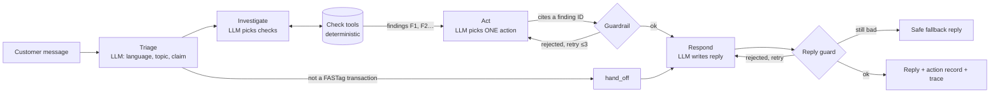

# TagFix agent (POC)

An LLM agent that resolves FASTag support tickets. It reads the customer's message in any language, checks their transactions with deterministic tools, takes one action, and replies. Every action has to cite evidence the checks produced, so the model can't make up a refund.

Built with **LangGraph + Gemini**, served by **FastAPI**, and tested with **pytest** (40 tests).



## What the LLM does and what code does

| | LLM (Gemini) | Code |
|---|---|---|
| Understand the message (English, Hinglish, Hindi, typos) | ✓ | |
| Decide which checks could confirm *or explain* the claim | ✓ | |
| Decide what's true (duplicate? overcharge? pass should've covered it? late posting?) | | ✓ `checks.py` |
| Choose the action | ✓ | |
| Allow the action, set amount / transaction / channel | | ✓ `tools.py` |
| Write the reply in the customer's language | ✓ | |
| Block invented IDs or amounts, false "refunded" claims, wrong script | | ✓ `guard.py` |

### Guardrails (all tested in `tests/test_guardrails.py`)

- **Actions cite findings.** `file_dispute`, `explain_charge`, `send_link` and `request_credit` take only a `finding_id`. The amount, transaction, evidence and channel come from the finding. The model can't pass an amount, and extra arguments are dropped.
- **Each finding allows one action.** A correct return-trip fare can be explained, never refunded. A late-posted toll gets a question ("was your car there on 10 Oct?") before any dispute.
- **One action per ticket.** Rejected actions go back to the model with the reason. After 3 tries the ticket goes to a human.
- **No checks, no action.** A dispute on a finding the model never received is rejected.
- **Reply guard.** Every `TX-`, `UPI-` and `D-` reference, rupee amount and time in the reply must appear in the verified facts. "Has been refunded", "paise wapas aa gaye", "guaranteed" and "within 24 hours" are blocked when no money has moved. Hindi customers get Devanagari. If the model fails twice, a safe fallback built from the facts is sent.
- **Non-FASTag topics never touch the account.** Car wash, challan, parking and delivery go to a human with no checks run.
- **Fails closed.** A model or network error returns 502 with "route to a human".

## Run it

```bash
cd agent
python -m venv .venv && . .venv/bin/activate
pip install -r requirements.txt
export GEMINI_API_KEY=...            # free key: https://aistudio.google.com/apikey
uvicorn tagfix_agent.service:app     # open http://localhost:8000 for the live trace console
```

Without a key, everything runs on an offline stand-in model, so the console, API and tests work out of the box.

```bash
python -m tagfix_agent --account rohan "toll pe paise do baar kat gaye"     # one ticket from the CLI
python -m pytest -q tests                                                    # 40 tests
python -m tagfix_agent.eval --offline                                        # plumbing + guardrails, all 90 tickets
python -m tagfix_agent.eval --live --sets held_out_3 --rpm 10                # the real test (~200 calls, ~20 min on a free tier)
```

Docker, from the repo root: `docker build -f agent/Dockerfile -t tagfix-agent . && docker run -p 8000:8000 -e GEMINI_API_KEY=... tagfix-agent`. `render.yaml` deploys it to Render.

### API

| Method | Path | |
|---|---|---|
| POST | `/v1/tickets/resolve` | `{"account_id": "rohan", "message": "...", "mode": "auto|live|offline"}` → decision, action, action record (e.g. dispute packet), reply, findings, full trace |
| GET | `/v1/accounts`, `/v1/accounts/{id}` | Demo accounts and passbooks |
| GET | `/health` | Mode and model |
| GET | `/` | Trace console |

## Results

| Run | Model | Decision correct | Closed without agent | Wrong actions |
|---|---|---|---|---|
| Offline, all 90 tickets | Stand-in policy (keyword rules) | 100% | 77–80% | **0** |
| Gemini adapter, network faked | Real `ChatGoogleGenerativeAI` request/response path | 1 full ticket in Hindi passes | | |
| **Live, Held-out 3** | **Gemini** | *run `eval --live` and paste here* | | |

The offline run tests the graph, tools and guardrails, not the model's understanding. The stand-in's keyword rules were tuned on these sets, so 100% means the plumbing works. **The live run is the real test, and it hasn't been run yet**: this sandbox has no Gemini key and can't reach Google's API. The request payloads (forced function calling, 10 check tools, 6 action tools, enum schemas) and response parsing are verified in `tests/test_gemini_adapter.py`.

`eval` writes every trace to `eval_results/`. It reports wrong actions separately, because one wrong "your charge is correct" costs more trust than ten handoffs.

## What's real and what's simulated

- **Real:** the agent, its tools and guardrails, the API, the Gemini integration, plaza locations and operators, and the public FASTag rules (Annual Pass coverage and trip counting, Nov 2025 2×/1.25× rule, NPCI blacklist timing).
- **Simulated:** accounts, transactions and tariffs (`data/`), and the action endpoints. `file_dispute` returns a dispute packet but doesn't call a bank. `store.py` is the one place an issuer-bank or NETC feed would plug in.
- **Next for production:**
  - Park+'s transaction feed, with both read and posted times.
  - Real dispute and credit APIs behind the action tools.
  - A checkpointer for multi-turn tickets (answering "no" to "was your car there?" should file the dispute).
  - Shadow mode on a few hundred real tickets before any customer sees a reply.

## Code map

```
tagfix_agent/
  checks.py    deterministic checks → findings (what's true)
  tools.py     check tools + guarded action tools, per-ticket Session
  graph.py     LangGraph: triage → investigate ⇄ checks → act → respond
  guard.py     reply validation
  prompts.py   system prompts per step
  models.py    Gemini factory, offline stand-in, scripted model for red-teaming
  service.py   FastAPI + console (static/console.html)
  eval.py      evaluation harness
  store.py     data access (shared JSON in ../data, exported from the JS engine)
```
